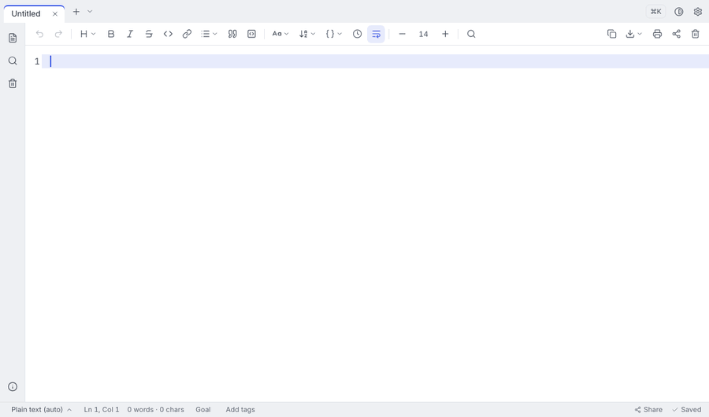
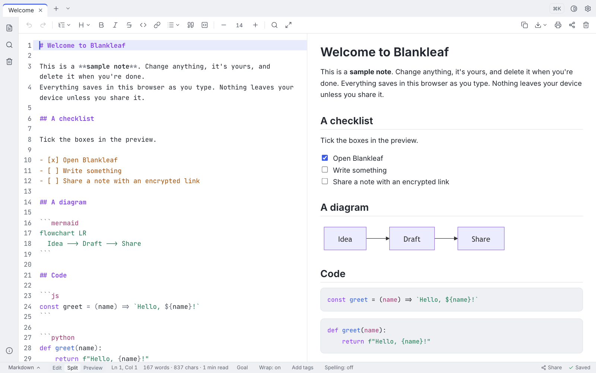
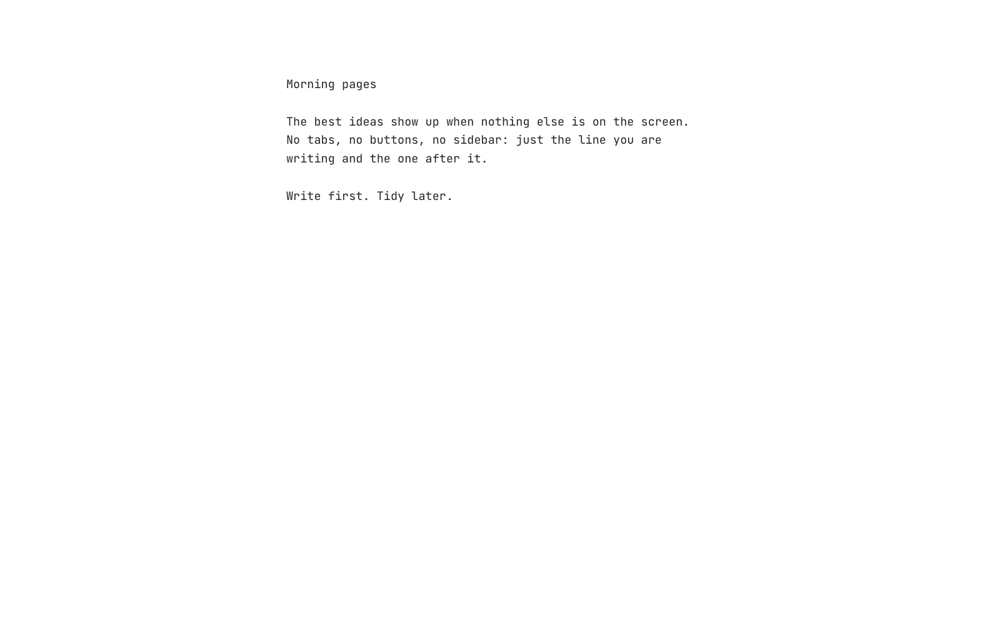
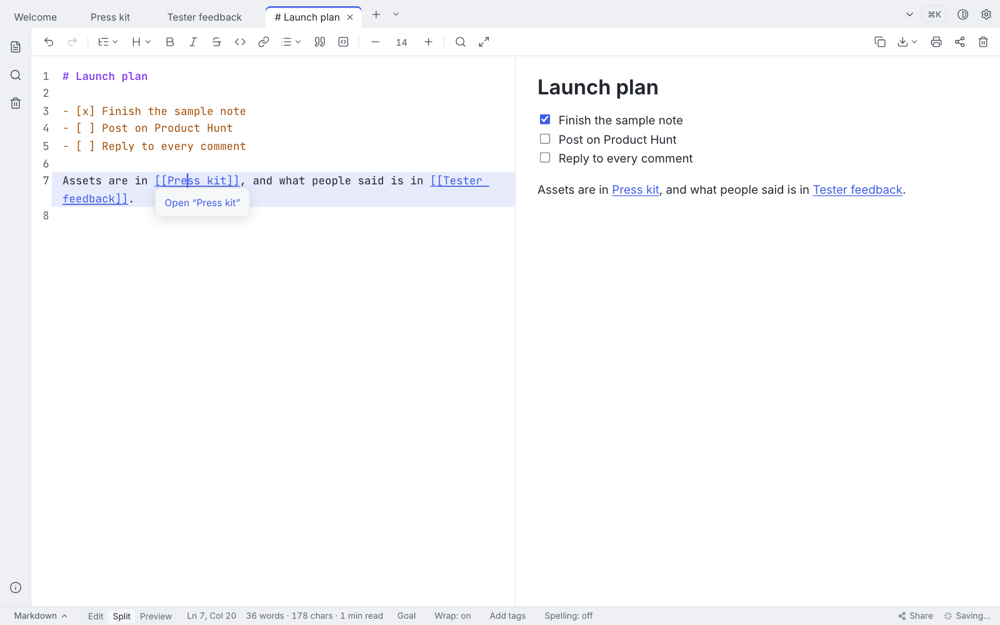
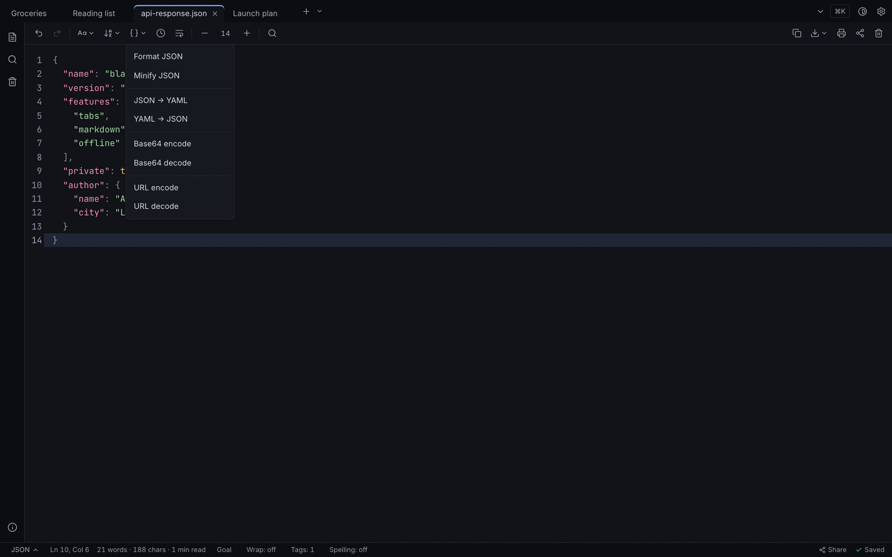
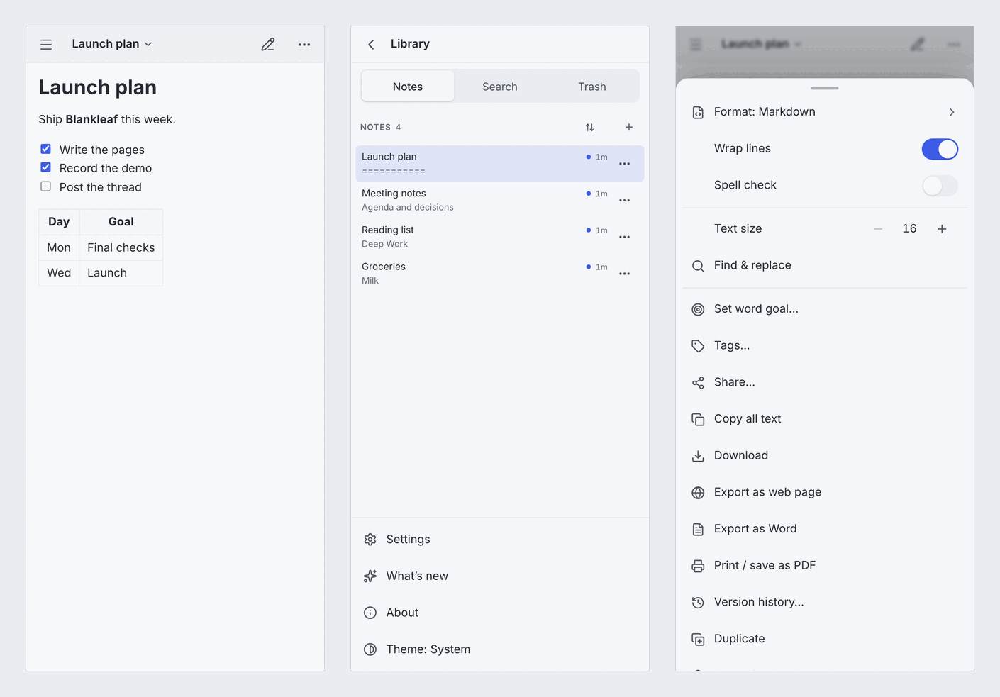
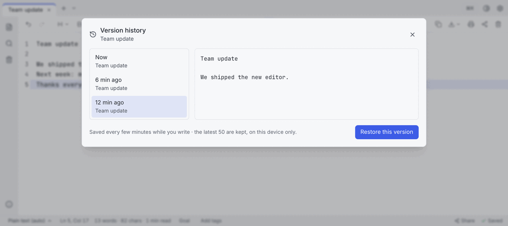
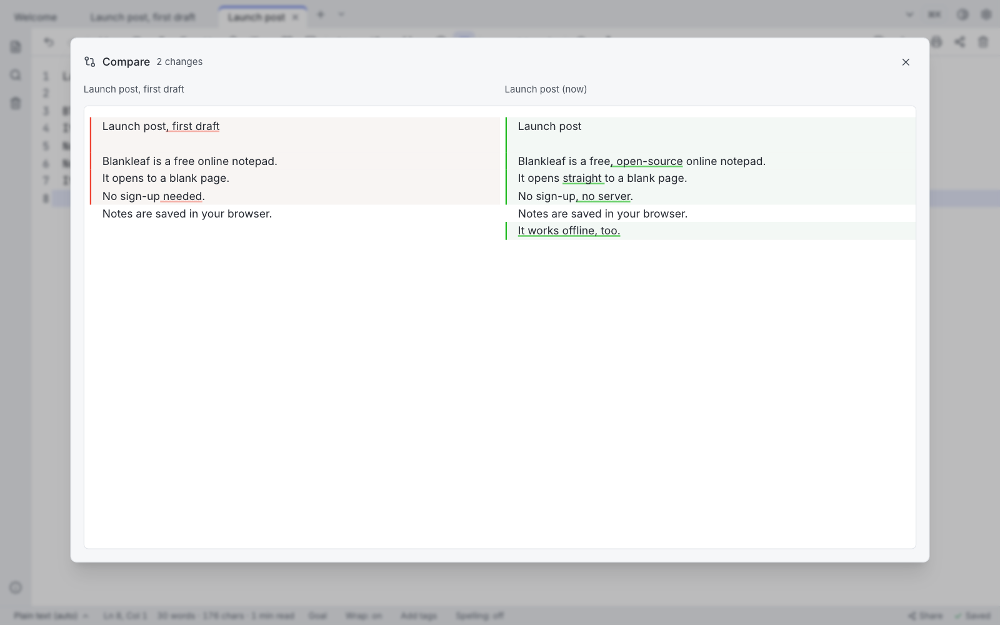

<div align="center">


# Blankleaf

**A free online notepad that opens straight to a blank page.**

No sign-up. No server. Your notes stay in your browser.

### [Open Blankleaf →](https://rajmalviya456.github.io/blankleaf/)

[](https://github.com/rajmalviya456/blankleaf/actions/workflows/ci.yml)
[](https://github.com/rajmalviya456/blankleaf/releases/latest)
[](LICENSE)



</div>

## Why Blankleaf

Most online notepads are a single text box, lose your work when the tab closes, or ask you to sign
up. Blankleaf gives you a real editor the moment the page opens, and it never needs an account.

- **Instant.** Open the page and start typing. Every visit begins on a blank note.
- **Private.** There is no backend. Notes are saved in your browser and work offline.
- **Complete.** Tabs, Markdown, links between notes, code highlighting, version history and
  encrypted sharing.



## Features

### Write

- **Tabs** for many notes at once, with pinning and drag to reorder
- **Markdown** with edit, split and preview views, clickable checklists, tables, Mermaid diagrams and math
- **Syntax highlighting** for 33 formats, detected as you type, with one-click Undo if the guess is wrong
- **Templates** for a daily journal, meeting notes, checklists and to-do lists
- **Voice typing** on a computer in Chrome, Edge and Safari
- **Reading time, word goals and spell check** for each note
- **Outline** of a Markdown note's headings, to jump straight to one
- **Two notes side by side** on wide screens

### Focus

Zen mode (⌃⌥Z on a Mac, Alt+Z elsewhere, or the button in the toolbar) goes full screen and shows only your words, in
a column about 70 characters wide. Nothing else on the screen until you press Esc.



### Link your notes

Type `[[` to link another note by its title. Links work in the editor and the Markdown preview,
a link to a note that doesn't exist yet creates it, and each note shows which notes link to it.



### Organize and find

- **Tags**, sorting and search across every note
- **Linked from**: see every note that links to the one you're reading
- **Command palette** (⌘K / Ctrl+K) for every action
- **Trash** that keeps deleted notes for 30 days

### Keep your work safe

- **Autosave** in your browser as you type
- **Version history** to read, compare and restore earlier text
- **Automatic backup to a folder** in browsers that support it, such as Chrome and Edge on a computer
- **Password-locked notes**, encrypted in your browser with AES-256
- **Backup and restore** with a single file

### Share and export

- **Encrypted share links** that expire, with an optional password ([how it works](#sharing-a-note))
- **Export** to Markdown, HTML or Word, or print and save as PDF
- **Download every note as files** in one .zip (.md, .txt, .py, …), to open in any app
- **Send to Blankleaf** from the Android Share menu once installed, and open text and code files on a computer

### For code and data

- Brackets and quotes close as you type, matching brackets light up, and blocks fold
- Enter keeps your indentation; ⌘/ (Ctrl+/) comments a line; Indent, Outdent and Comment buttons on phones
- JSON errors are underlined as you type
- Format or minify JSON, convert JSON ⇄ YAML, and encode or decode Base64 and URLs
- Sort lines, remove duplicates, change case and find and replace



### On your phone

A layout made for small screens, with the toolbar above the keyboard. Install it like an app and it
works offline.



### Never lose a good draft



Compare any version, or any two notes, side by side with every change marked:



## Privacy

There is no backend. Notes are stored in your browser's IndexedDB and never leave your machine
unless you export them or share one. Clearing site data for the page deletes them, so export a
backup now and then.

## Keyboard shortcuts

On macOS **⌃⌥** is Control+Option; on Windows/Linux it is **Alt**.

| Action                          | macOS     | Windows / Linux |
| ------------------------------- | --------- | --------------- |
| Command palette                 | ⌘K        | Ctrl+K          |
| New note                        | ⌃⌥N       | Alt+N           |
| Close tab                       | ⌃⌥W       | Alt+W           |
| Reopen closed tab               | ⌃⌥⇧T      | Alt+Shift+T     |
| Next / previous tab             | ⌃⌥] / ⌃⌥[ | Alt+] / Alt+[   |
| Go to tab 1–9                   | ⌃⌥1 … ⌃⌥9 | Alt+1 … Alt+9   |
| Rename note                     | F2        | F2              |
| Save note as a file             | ⌘S        | Ctrl+S          |
| Print / save as PDF             | ⌘P        | Ctrl+P          |
| Markdown edit / split / preview | ⌃⌥P       | Alt+P           |
| Toggle sidebar                  | ⌘B        | Ctrl+B          |
| Search all notes                | ⌘⇧F       | Ctrl+Shift+F    |
| Find & replace in note          | ⌘F        | Ctrl+F          |
| Zen mode                        | ⌘. or ⌃⌥Z | Ctrl+. or Alt+Z |
| Comment line (code notes)       | ⌘/        | Ctrl+/          |
| Keyboard shortcuts              | ⌘/        | Ctrl+/          |

Outside a code note, ⌘/ (Ctrl+/) opens the list of shortcuts.

When installed as an app, ⌘T / ⌘W (Ctrl+T / Ctrl+W) also open and close tabs.

## Sharing a note

Click **Share** in the status bar or toolbar (or **Share…** in a tab's menu, or _Share note…_
in the palette):

1. Pick how long the link works — **5 min** (default), 1 hour, 1 day or 7 days.
2. Keep **Protect with password** on (a random `xxxx-xxxx-xxxx` password is generated; ↻ for a
   new one) or switch it off.
3. **Create link** — a ready-to-send message with the link, password and expiry is copied.

The recipient opens the link, types the password and gets a read-only copy they can **Save to
my notes** or **Download**.

How it works, and what to know:

- **No server stores your note.** It's encrypted in your browser (AES-256-GCM, key in the
  link's `#fragment`, password stretched with PBKDF2) and sent directly to the recipient's
  browser over WebRTC. A free public PeerJS server only introduces the two browsers; it never
  sees the note, key or password.
- **Keep Blankleaf open** until the link has been opened. If you close it, the link waits;
  reopen Blankleaf before the expiry and the same link works again.
- **Expiry is real**: when it passes (or you click _Stop sharing_), your browser stops answering
  and forgets the key — the link can never deliver the note again. Anyone who opened it before
  then can keep their copy.
- **The password is checked by your browser** before anything is sent; after 5 wrong tries it
  pauses attempts (30 s, doubling). For confidential notes, send the password a different way
  than the link.
- The status bar shows **Sharing N notes · m:ss left**; click it to see every active share, copy
  its message again, or stop it.
- If a direct browser-to-browser connection isn't possible, PeerJS's free relay may forward the
  data — still encrypted end to end, so the relay can't read it. If even that fails, the
  recipient is told to try another network.

## Tech stack

[Vite](https://vite.dev) · [React 19](https://react.dev) · TypeScript ·
[Zustand](https://zustand.docs.pmnd.rs) (state) · [Dexie](https://dexie.org) (IndexedDB) ·
[CodeMirror 6](https://codemirror.net) (editor) · [Tailwind CSS v4](https://tailwindcss.com) ·
[Radix UI](https://www.radix-ui.com) · [cmdk](https://cmdk.paco.me) ·
[dnd-kit](https://dndkit.com) · [PeerJS](https://peerjs.com) (sharing) ·
[vite-plugin-pwa](https://vite-pwa-org.netlify.app). Tests: Vitest, Testing Library,
Playwright + axe.

## Project layout

```
src/
  app/          App shell and layout (tab bar, rail, sidebar, editor area, status bar)
  commands/     Command registry — every action, its shortcuts and palette entry
  db/           Dexie schema and persistence
  domain/       Types, defaults, pure note logic (titles, formats, detection)
  features/     editor, toolbar, tabs, sidebar, palette, settings, backup, sync, share, help
  store/        Zustand store and selectors
  lib/  ui/     Small shared helpers and UI primitives (toasts, dialogs)
e2e/            Playwright end-to-end and accessibility tests
docs/           Design specs and implementation plans
```

## Development

Requires **Node 24**.

```bash
npm install
npm run dev          # dev server at http://localhost:5173/
npm test             # unit tests (Vitest)
npm run e2e          # end-to-end + accessibility tests (Playwright)
npm run lint         # ESLint
npm run typecheck    # TypeScript
npm run format       # Prettier
npm run build        # production build (served from /blankleaf/)
```

See [CONTRIBUTING.md](CONTRIBUTING.md) for how to propose changes.

## Versions and releases

Blankleaf follows [Semantic Versioning](https://semver.org). Versions are worked out from the
[Conventional Commits](https://www.conventionalcommits.org/) on `main` by
[release-please](https://github.com/googleapis/release-please):

| Commits since the last release              | Next version  |
| ------------------------------------------- | ------------- |
| only `fix:` / `perf:`                       | 1.0.0 → 1.0.1 |
| at least one `feat:`                        | 1.0.0 → 1.1.0 |
| a `!` (e.g. `feat!:`) or `BREAKING CHANGE:` | 1.0.0 → 2.0.0 |

1. Every push to `main` runs CI, and release-please opens (or updates) a pull request named
   **`chore(main): release x.y.z`** that bumps `package.json` and adds the new section to
   [`CHANGELOG.md`](CHANGELOG.md).
2. **Merging that pull request is the release**: it tags `vx.y.z`, publishes a GitHub Release
   with the notes, and deploys the site.

The app reads `CHANGELOG.md` at build time: **What's new** (in About or the command palette)
shows the release notes offline, and after an update the app says _"Blankleaf was updated to
x.y.z"_ once.

## Deploy (GitHub Pages)

The built app is published to a separate **`gh-pages`** branch — build output is never committed
to `main`.

One-time setup on GitHub: **Settings → Pages → Source: Deploy from a branch → Branch:
`gh-pages` / `(root)`**.

- **Automatic:** merging a release pull request runs `.github/workflows/deploy.yml` (lint,
  typecheck, tests, build) and publishes `dist/` to `gh-pages`.
- **By hand:** _Actions → Deploy → Run workflow_ redeploys `main` without a new version.
- **Manual:** `npm run deploy` builds and pushes `dist/` to `gh-pages` from your machine.

Icons are generated from `public/logo.svg` with `npm run icons`.

## Docs

- App design: [`docs/superpowers/specs/2026-11-16-blankleaf-design.md`](docs/superpowers/specs/2026-11-16-blankleaf-design.md)
- Sharing design: [`docs/superpowers/specs/2026-11-17-share-by-link-design.md`](docs/superpowers/specs/2026-11-17-share-by-link-design.md)
- Toolbar design: [`docs/superpowers/specs/2026-11-17-toolbar-design.md`](docs/superpowers/specs/2026-11-17-toolbar-design.md)
- Implementation plans: [`docs/superpowers/plans/`](docs/superpowers/plans/)

## License

[MIT](LICENSE) © 2026 Raj Malviya
